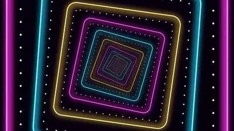

# AgentFX

**Motion graphics and video effects for AI agents.** A native CPU/GPU renderer, no browser.

<p>
  
  
</p>

An agent such as Claude Code, Codex or any MCP client writes a short script in **Reel Script**
(`.reel`). AgentFX lints it with fix hints, shows single frames and contact sheets so the agent
can look before it renders, and renders the video with its own Rust renderer. Output is exactly
what the script says (copy, brand colours, timing), and the same script always gives the same
frames.

Website: [agentfx.dev](https://agentfx.dev) · Videos: [YouTube @agentfxdev](https://www.youtube.com/@agentfxdev) · Trailer: [watch on YouTube](https://youtu.be/R8wOTUdO-5Y)

## Quick start (Linux)

You need Rust stable (1.85 or newer) and `ffmpeg`. Optional: a Vulkan driver for GPU effects,
and [piper](https://github.com/OHF-Voice/piper1-gpl) for text to speech.

```sh
git clone https://github.com/agentfxhq/agentfx && cd agentfx
tools/install.sh        # builds, installs agentfx + agentfx-render to ~/.local/bin, data to ~/.local/share/agentfx
```

Or build in place with `cargo build --release` (binaries in `target/release/`). Details and all
environment variables: [docs/BUILD.md](docs/BUILD.md).

Write `hello.reel` (also in [examples/quickstart.reel](examples/quickstart.reel)):

```
video "Hello AgentFX" size=1280x720 fps=30 captions=off
scene ink dur=4s
  layer #film x=0 y=0 w=100% h=100%
    fluid #ink res=1/4 vorticity=18 seed=3 color=#3CBF87
    text #word "AGENTFX" size=200 weight=900 color=#3CBF87 x=50% y=50% anchor=center nowrap
      when portrait
        set #word size=110
  @1s ink #word into #ink dur=0.5s noise=400
  @1.4s stir #ink at=50%,50% radius=30% strength=3 dur=1.4s
```

Then lint, look, render:

```sh
agentfx lint hello.reel --measure --all-formats   # JSON diagnostics, checked in 16:9 and 9:16
agentfx frame hello.reel --at 2.2s -o frame.png   # one frame, to look at
agentfx sheet hello.reel -o sheet.png             # a contact sheet of the whole video
agentfx render hello.reel -o hello.mp4            # the video (.gif, .webp, .mov, .webm by extension)
agentfx render hello.reel --format 9:16 -o hello-vertical.mp4
```

`agentfx catalog --md` lists everything the format can do; [docs/SPEC.md](docs/SPEC.md) is the
full Reel Script reference. More examples: [examples/features/](examples/features/) (one effect
per file), [examples/showcase.reel](examples/showcase.reel), [examples/components.reel](examples/components.reel).

## Use with Claude Code, Codex and MCP

**Skill.** [skill/agentfx/](skill/agentfx/) is an agent skill: quick mode (write, lint, look,
render) by default, and an optional director mode that agrees on brief, directions, dramaturgy,
storyboard and hero variants before the full render. For Claude Code, copy or link the folder
into `~/.claude/skills/agentfx/`; other agents can read `SKILL.md` as instructions.

**MCP server.** [mcp/server.py](mcp/server.py) (Python standard library only) exposes
`agentfx_spec`, `agentfx_catalog`, `agentfx_lint`, `agentfx_timing`, `agentfx_frame`,
`agentfx_sheet`, `agentfx_render`, `agentfx_design_guide`, `agentfx_lens` and an optional
`agentfx_critique`. Frames and sheets come back as images, so the agent can look at its work.

```sh
claude mcp add agentfx -- python3 /path/to/agentfx/mcp/server.py
# after tools/install.sh:
claude mcp add agentfx -- python3 ~/.local/share/agentfx/mcp/server.py
```

Any MCP client that speaks stdio works the same way (for Codex, add the same command as an MCP
server in its config). Without MCP, agents simply call the `agentfx` CLI: every command prints
JSON.

**Director desk (optional).** [director/](director/) holds a small local web page and a second
MCP server for director mode: the agent posts decision cards, you answer them in the browser.
It binds to 127.0.0.1 only and has no authentication. See [skill/agentfx/desk.md](skill/agentfx/desk.md).

## Effects

- **Fluid and ink:** a 2D fluid solver: pour, stir, dissolve a word into ink, reveal a layout through a stain.
- **Physics:** drop, pile, push and swing; rigid bodies solved at compile time and baked into keyframes.
- **Shatter:** Voronoi fracture for text, logos and shapes, driven by the same physics.
- **Slit-scan and time displacement, time remap, rewind, echo:** effects that need the frames before and after.
- **Infinite zoom:** seamless loops with nested worlds and a constant-speed camera.
- **Glitch, RGB split, VHS and CRT, dither, ASCII:** seeded looks, animatable per layer.
- **Halftone, risograph, grain, colour grading and LUTs.**
- **Light on flat design:** soft shadows from distance fields, light sweeps, god rays.
- **Kinetic typography:** per letter, word or line animators, variable font axes, OpenType features, strokes, text on a path.
- **Audio:** beat and bar anchors, properties driven by the music, spectrum and waveform visualizers.
- **Captions:** word-by-word styles from SRT, VTT or Whisper JSON, with safe-area and read-time lint.
- **Presenter:** a rigged character with lip sync, gestures and moods.
- **Point clouds and world camera:** tens of thousands of particles, camera tours over one large canvas.
- **Layout and components:** cards, stats, charts, diagrams, code with diffs, browser and phone mockups, a 2.5D camera.
- **Motion blur** (shutter-accurate), masks and mattes, blend modes.

Output: MP4 (H.264 via x264, VAAPI/QSV or NVENC), ProRes 4444 and VP9 with alpha, GIF, animated
WebP, PNG sequences; 16:9, 9:16, 1:1 and 4:5 from one script.

## Status and limits

AgentFX is early software (0.1.0). Expect the format and the CLI to change.

- **Platforms:** tested on Linux (x86_64). macOS and Windows are experimental and untested.
- **GPU:** GPU effects use Vulkan only (via wgpu). Without a usable GPU (common in
  containers, CI, and WSL) everything renders on the CPU automatically. Set
  `AGENTFX_GPU=0` to skip the GPU probe. See [docs/BUILD.md](docs/BUILD.md) for details.
- **No true 3D:** a 2.5D camera, parallax and projected point clouds, but no 3D meshes or lighting.
- **No timeline editor:** the script is the source of truth.
- **Text to speech:** piper (local) is the default. The `edge` engine uses an undocumented
  online service and is opt-in only; see [docs/INSTALL-NOTES.md](docs/INSTALL-NOTES.md).
- **Music:** bring your own track; AgentFX analyses it for beats but does not compose.
- **HTML input:** the renderer also takes HTML/CSS scenes with CSS animations
  ([docs/INPUT.md](docs/INPUT.md)); full CSS and JavaScript are not supported.

## Repository layout

| Path | What |
|---|---|
| `crates/ir` | `agentfx-ir`: the intermediate representation ([docs/IR.md](docs/IR.md)) |
| `crates/render` | `agentfx-render`: the renderer (IR or HTML scene to video) |
| `crates/script` | `agentfx`: the Reel Script compiler and main CLI |
| `vendor/` | patched Blitz, Parley and Stylo crates ([vendor/README.md](vendor/README.md)) |
| `assets/`, `design/` | bundled fonts (OFL), design lenses and component skins |
| `examples/` | Reel Script examples, IR and HTML samples |
| `docs/` | spec, IR and input formats, build notes |
| `tools/`, `mcp/`, `skill/`, `director/` | helper scripts, MCP server, agent skill, director desk |

## Licence

Apache License 2.0, see [LICENSE](LICENSE). Copyright 2026 Levels Branding and Webdevelopment OG.
Third-party code and fonts keep their own licences (MIT/Apache-2.0, MPL-2.0 for the vendored
Stylo, OFL-1.1 for the fonts); see [NOTICE](NOTICE).

Security issues: see [SECURITY.md](SECURITY.md). Contributions: [CONTRIBUTING.md](CONTRIBUTING.md).
